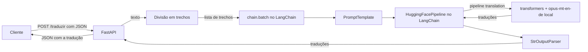

# DR3 TP2 | Parte 2, Questão 3: tradução inglês-alemão com Hugging Face via LangChain (FastAPI)

API em FastAPI que recebe um texto em inglês e devolve a tradução para o alemão. O modelo `Helsinki-NLP/opus-mt-en-de` roda localmente e é gerenciado pelo LangChain (`PromptTemplate | HuggingFacePipeline | StrOutputParser`). Textos longos são divididos em trechos (por frase, até 400 tokens cada) e traduzidos com `chain.batch`.

## Estrutura

```
├── app/
│   ├── main.py       # API FastAPI e carregamento do modelo na inicialização
│   ├── schemas.py    # modelos Pydantic de entrada e saída
│   └── service.py    # cadeia do LangChain e divisão do texto em trechos
├── tests/test_api.py
├── requirements.txt
└── README.md
```

## Arquitetura



Interações: a rota FastAPI divide o texto; o LangChain organiza a execução em lote (prompt, modelo, parser); o `HuggingFacePipeline` é a ponte para o pipeline `translation` da biblioteca `transformers`, que executa o modelo na própria máquina, sem chamada externa depois do download.

## Requisitos

- Python 3.12
- Conexão com a internet na primeira execução: o modelo (cerca de 300 MB) é baixado para o cache da Hugging Face (`~/.cache/huggingface`).
- `transformers` na versão 4.x: o pipeline `translation` não é mais suportado no `transformers` v5.

## Instalação

```bash
python -m venv .venv
# Windows
.venv\Scripts\activate
# Linux/macOS
source .venv/bin/activate

pip install -r requirements.txt
```

## Execução

```bash
uvicorn app.main:app --reload
```

- API: http://127.0.0.1:8000
- Documentação interativa (Swagger): http://127.0.0.1:8000/docs

## Uso

`POST /traduzir`

| Campo | Tipo | Descrição |
|-------|------|-----------|
| `texto` | texto (1 a 10.000 caracteres) | texto em inglês; quebras de linha são preservadas |

```bash
curl -X POST http://127.0.0.1:8000/traduzir -H "Content-Type: application/json" -d '{"texto": "Good morning! How are you today?"}'
```

Resposta:

```json
{
  "texto_original": "Good morning! How are you today?",
  "traducao": "...",
  "trechos": 1,
  "tempo_ms": 400.7
}
```

`GET /health` informa o estado da API e o modelo carregado.

## Testes

```bash
pytest
```

Os testes usam um Fake LLM do LangChain e não baixam o modelo. Para testar também com o modelo de verdade:

```bash
# Linux/macOS
RODAR_MODELO_REAL=1 pytest
# Windows (PowerShell)
$env:RODAR_MODELO_REAL = "1"; pytest
```
